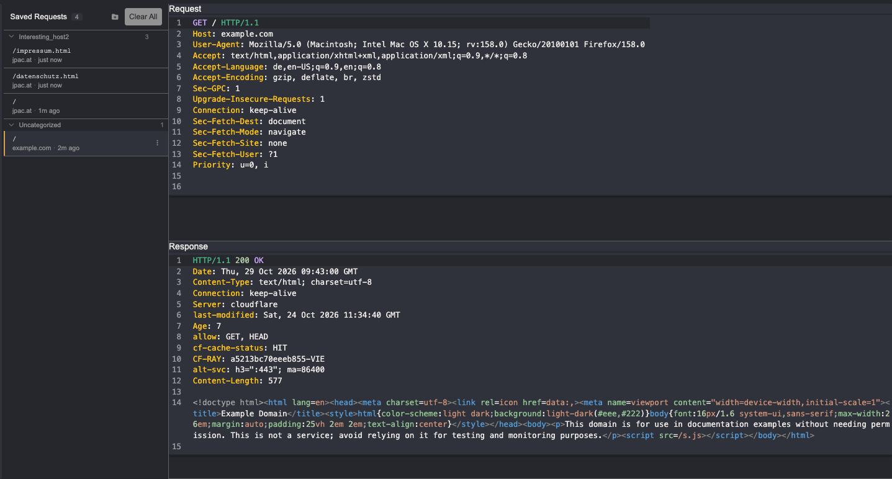
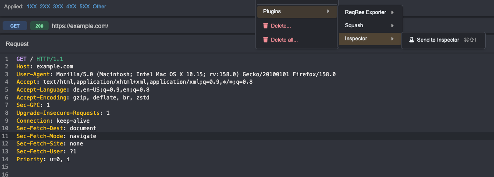

# Inspector

Save interesting requests to a persistent list for later review.

Right-click any request and choose **Plugins → Inspector → Send to Inspector** (or press Cmd/Ctrl+Shift+I):

Mostly vibecoded and in daily use by me.

## Why?

Counterpart to the Burp [Inspector](https://portswigger.net/burp/documentation/desktop/tools/inspector), and I missed it in Caido.

## Why not just use the "Findings" Tab?

I do see a distinction between "interesting" and immediately reportable. Requests and Responses can be interesting for many reasons, and worth a later look.
